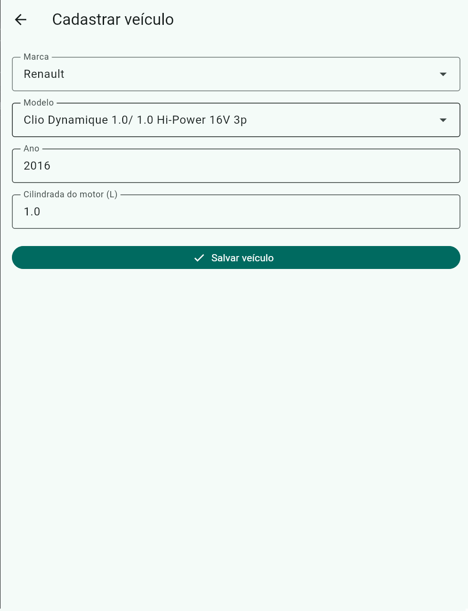
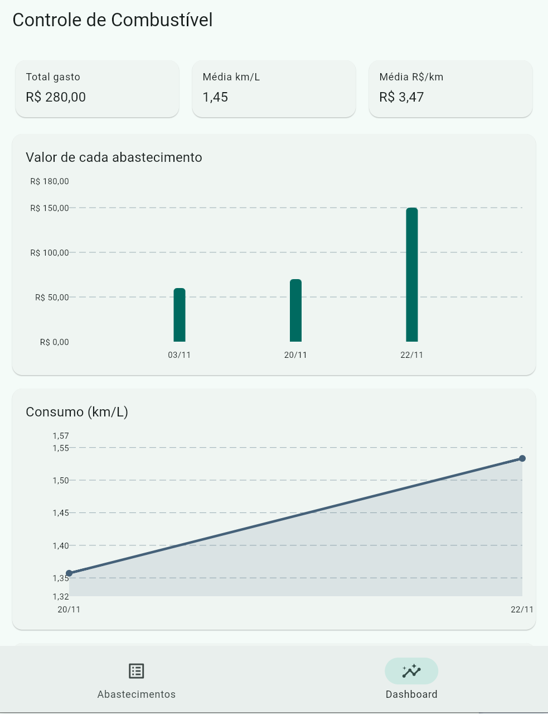

# Controle de Combustível

Aplicativo Flutter para registrar os abastecimentos de um veículo e acompanhar gastos e consumo ao longo do tempo.
Atividade Substitutiva da Prova 1 — Programação para Dispositivos Móveis II (Prof. Arley).

## Descrição

- **Cadastro de um veículo por vez**: marca e modelo vêm da API pública (o modelo depende da marca escolhida); ano e cilindrada são digitados. Para cadastrar outro veículo, é preciso excluir o atual (com confirmação), o que também apaga os abastecimentos dele.
- **Abastecimentos**: tipo de combustível (etanol, gasolina ou diesel), preço por litro, litros, quilometragem e data/hora. O valor total (preço × litros) é calculado automaticamente.
- **Persistência local**: veículo e abastecimentos continuam salvos após fechar o app.
- **Dashboard**: valor de cada abastecimento, consumo (km/L) e custo por quilômetro (R$/km) em gráficos.

Indicadores (a partir do 2º abastecimento, considerando tanque cheio):

```
distância = km atual − km do abastecimento anterior
km/L      = distância ÷ litros do abastecimento atual
R$/km     = valor total do abastecimento atual ÷ distância
```

O primeiro abastecimento é só referência e não exibe km/L nem R$/km.

## Como executar

Pré-requisitos: [Flutter SDK](https://docs.flutter.dev/get-started/install) (Dart 3.5+) e um emulador ou dispositivo conectado.

```bash
# 1. Entre na pasta do projeto
cd controle_combustivel

# 2. Gere as pastas de plataforma (android/, ios/, ...) que não estão no repositório
flutter create . --project-name controle_combustivel

# 3. Instale as dependências
flutter pub get

# 4. Execute
flutter run
```

Para rodar os testes: `flutter test`

> **Android:** para a consulta à API funcionar em build *release*, confirme que `android/app/src/main/AndroidManifest.xml` contém, antes de `<application>`:
> `<uses-permission android:name="android.permission.INTERNET"/>`
> (em *debug* já funciona).

## API utilizada

[BrasilAPI — FIPE](https://brasilapi.com.br/docs#tag/FIPE)

- Marcas: `GET https://brasilapi.com.br/api/fipe/marcas/v1/carros`
- Modelos da marca: `GET https://brasilapi.com.br/api/fipe/veiculos/v1/carros/{codigoMarca}`

## Bibliotecas

| Pacote | Uso |
| --- | --- |
| `http` | Consumo da BrasilAPI |
| `shared_preferences` | Persistência local (JSON) |
| `fl_chart` | Gráficos do dashboard |
| `intl` / `flutter_localizations` | Formatação de moeda e datas em pt-BR |

## Estrutura

```
lib/
├── main.dart
├── models/      vehicle.dart, fueling.dart (inclui cálculo dos indicadores)
├── services/    fipe_service.dart, storage_service.dart
├── state/       app_state.dart
├── screens/     home_screen, vehicle_form_screen, fueling_form_screen, dashboard_view
└── utils/       format.dart
```

## Capturas de tela

Adicione as imagens em `docs/screenshots/` e ajuste os nomes abaixo.

| Cadastro do veículo | Lista de abastecimentos | Novo abastecimento | Dashboard |
| --- | --- | --- | --- |
|  |  |  |  |
